# MyCent

**A full-stack platform for pawnshop operations and multichannel commerce.**

MyCent is an engineering-thesis project that brings in-store sales, online shopping, pawn agreements and customer service into a single web application. It was designed for a network of pawnshops where inventory, transactions, customers and staff permissions need to remain consistent across physical and online channels.

> **Project status:** working technical prototype developed as an engineering thesis. It is **not** a production-ready, legally compliant pawnshop solution; regulatory compliance, security hardening and production operations require additional work.

[Polska wersja README](README.pl.md) · [Screenshot gallery](docs/gallery/README.md) · [Diagrams & ERD](docs/README.md) · [Performance results](#testing-and-performance)

## Preview

<p align="center">
  <a href="docs/gallery/storefront/home-light.png">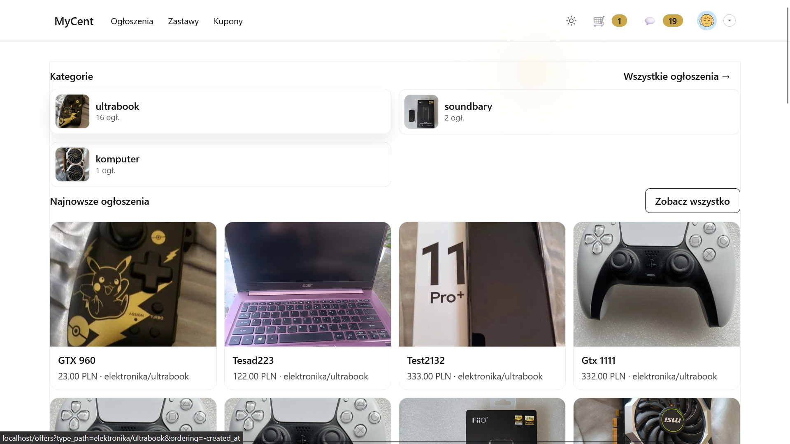</a>
</p>

<p align="center"><sub>Storefront · public marketplace · light theme</sub></p>

| Listing discovery & filtering | Item details & shopping cart |
|:---:|:---:|
| <a href="docs/gallery/marketplace/listings-filters.png">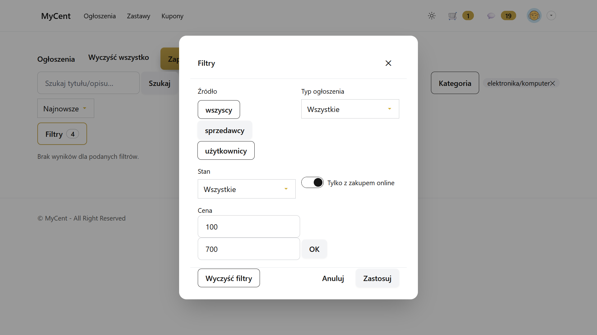</a> | <a href="docs/gallery/marketplace/item-detail.png">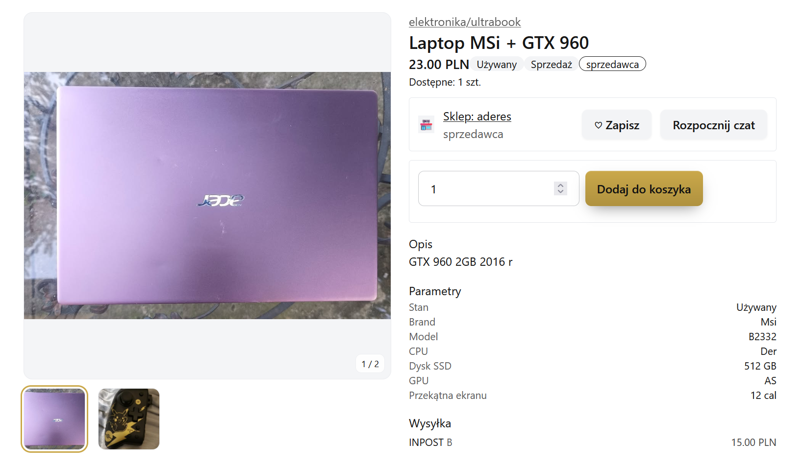</a> |
| **Seller POS / in-store sales** | **Pawn agreement details** |
| <a href="docs/gallery/checkout/pos-stock-picker.png">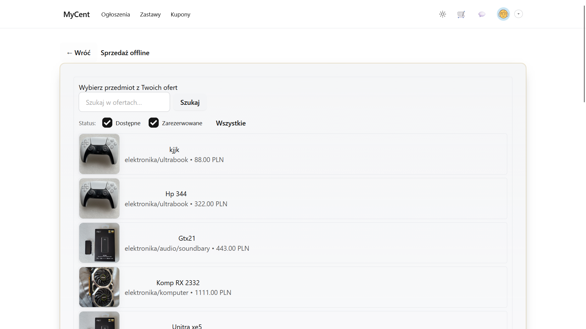</a> | <a href="docs/gallery/pawns/pawn-agreement-detail.png">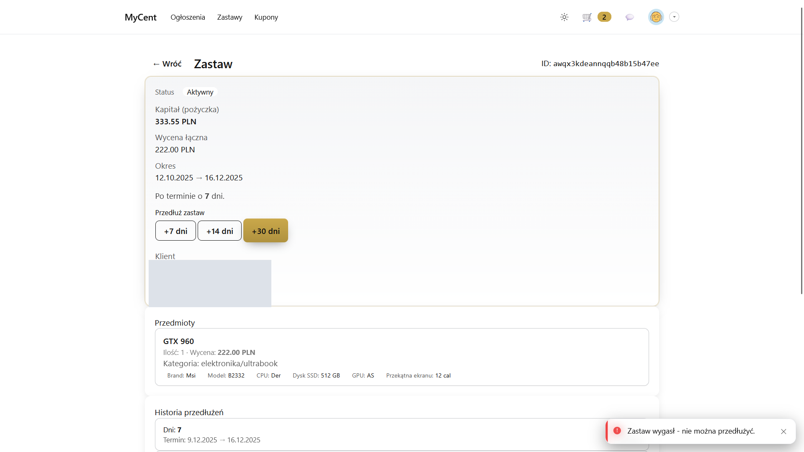</a> |

| Chat via WebSocket | Checkout & payment |
|:---:|:---:|
| <a href="docs/gallery/communication/chat-conversation.png">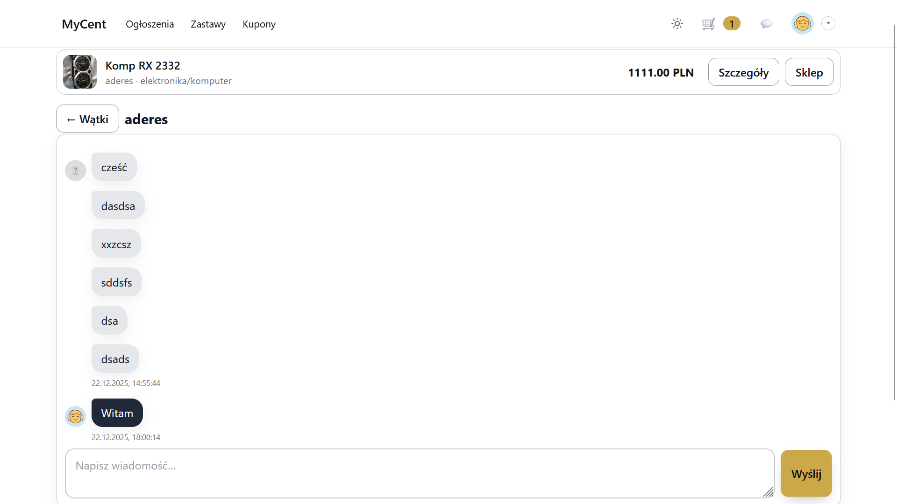</a> | <a href="docs/gallery/checkout/checkout-order.png">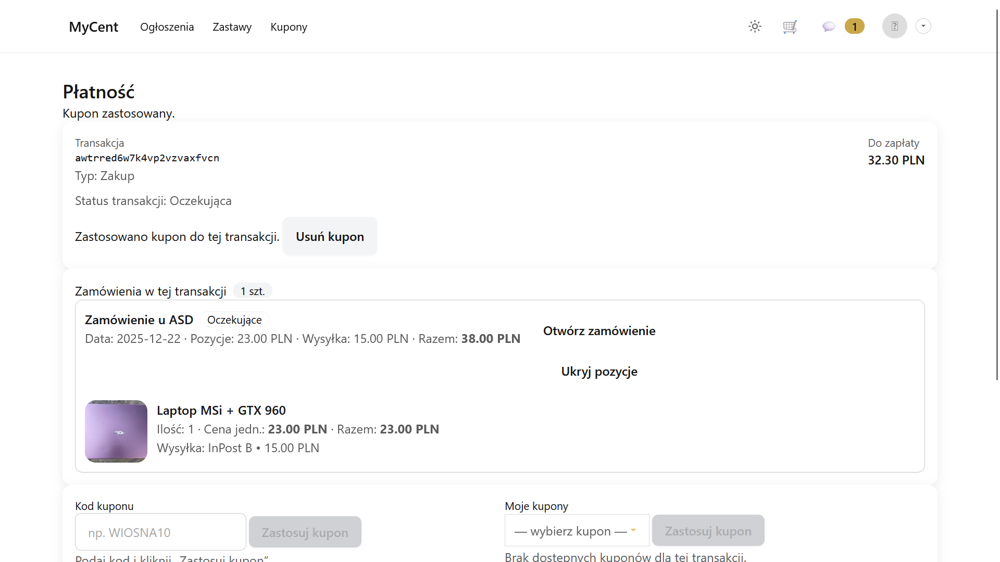</a> |

[**Explore all 72 application screenshots →**](docs/gallery/README.md) · [Diagrams, UML, ERD & load charts](docs/README.md)

## What the application does

| Area | Capabilities |
| --- | --- |
| **Pawnshop operations** | Create pawn agreements, record pledged items and valuations, extend or redeem agreements, process forfeitures and optionally create listings for unredeemed items. |
| **Online marketplace** | Public listing catalog, categories, searchable and filterable offers, listing details, images, favorites and saved searches. |
| **Omnichannel sales** | Shopping cart, online checkout, physical-store checkout, orders, stock deductions and temporary item reservations. |
| **Payments & discounts** | Shared transaction model, electronic payment integration through Stripe, test payment adapter, discount coupons and loyalty points. |
| **Customers & stores** | Central customer records, seller profiles, store memberships, employee roles and permission-scoped operations. |
| **Communication** | Real-time customer/seller chat, WebSocket notifications, transactional emails and price-drop notifications. |
| **Administration** | Django Admin, user/store management, listing moderation and OpenAPI/Swagger-based API documentation. |

The interface supports different perspectives: visitors, customers, sellers/store employees, moderators and administrators. Features are exposed according to the signed-in user's role and store membership.

## Tech stack

| Layer | Technologies |
| --- | --- |
| Backend & API | Python, Django, Django REST Framework, JWT, OpenAPI / Swagger UI |
| Frontend | Django templates, JavaScript, HTMX, Alpine.js, Tailwind CSS, DaisyUI |
| Database & messaging | PostgreSQL, Redis |
| Background processing | Celery and scheduled tasks |
| Real-time communication | Django Channels, ASGI, WebSocket |
| Payments | Stripe API / webhooks, local test provider |
| Infrastructure & development | Docker, Docker Compose, Caddy, Mailpit, Stripe CLI |
| Testing | Django unit/integration tests, Locust |

## Architecture

MyCent uses a **modular monolith**: separate Django applications encapsulate business areas while sharing a PostgreSQL database. REST endpoints and server-rendered templates are backed by a service layer that implements business rules; background jobs and WebSocket messaging use Redis.

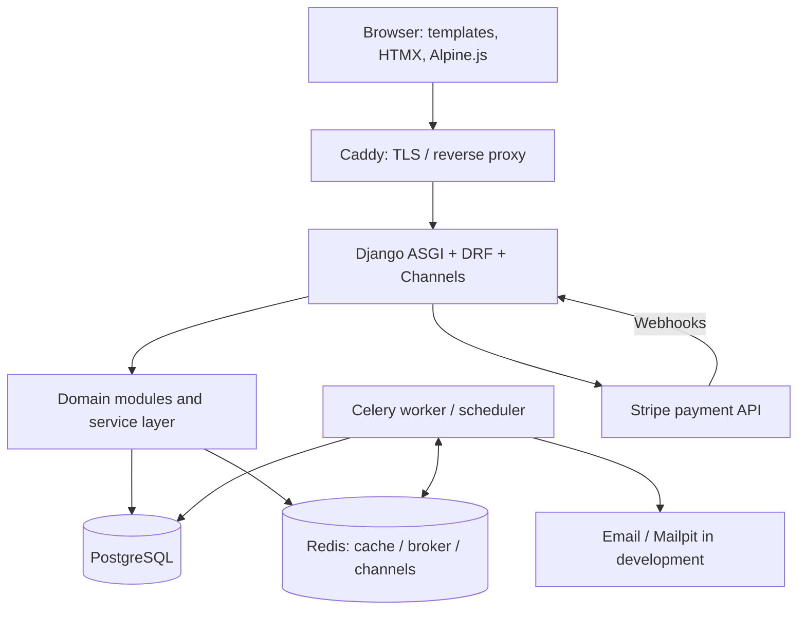

**Module dependencies:**

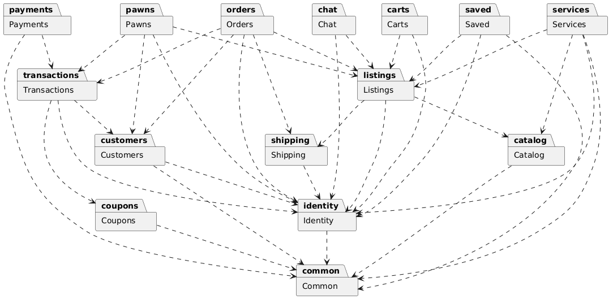

The principal domain apps are `identity`, `catalog`, `listings`, `carts`, `orders`, `pawns`, `transactions`, `payments`, `coupons`, `customers`, `shipping`, `saved`, `services` and `chat`, supported by `common`, `core` and `config`.

### Key design decisions

- **One transaction model:** `Transaction` represents purchases, pledges, pawn extensions and redemptions. Orders, agreements and payments relate to their respective transactions.
- **Inventory consistency:** checkout uses time-limited reservations, database transactions and row-level locking (`select_for_update`) to reduce the risk of overselling across sales channels.
- **Service-oriented domain logic:** REST views delegate business rules to `services/commands.py`, queries and repositories rather than implementing workflows directly in controllers.
- **Traceable historical data:** order and pawn snapshots preserve the information used at the time of an operation even if source records later change.
- **Asynchronous side effects:** Celery handles reservation expiry, saved-search refreshes, price-drop detection and email notifications.

### Database model — ERD

The database model is documented as a two-part ERD. The overview below is **included directly in this README**; select a part to inspect every table and relationship at full resolution.

<p align="center">
  <a href="docs/architecture/erd-part-1.png">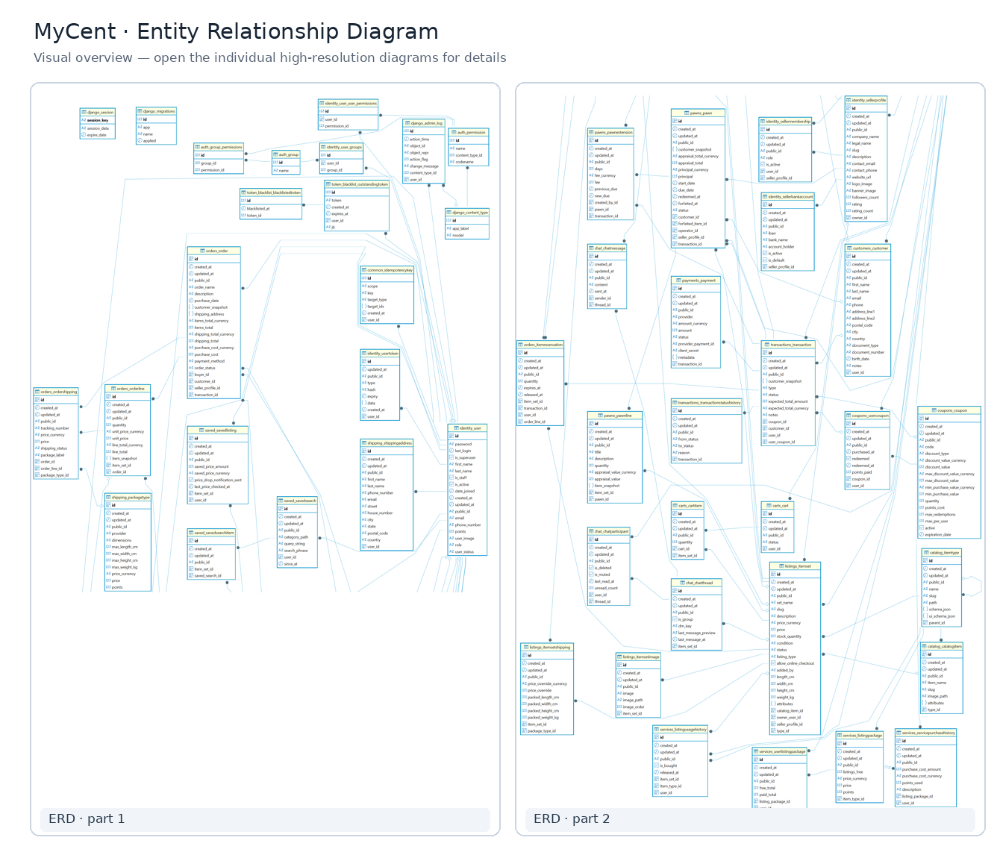</a>
</p>

[**Open ERD — part 1**](docs/architecture/erd-part-1.png) · [**Open ERD — part 2**](docs/architecture/erd-part-2.png) · [All architecture diagrams](docs/README.md)

[Domain class diagram](docs/architecture/business-domain-classes.png).

## Core business workflows

### Online purchase

1. A customer adds an eligible listing to their cart.
2. Checkout creates a pending `PURCHASE` transaction, order lines and stock reservations (typically grouping orders by seller).
3. Shipping options and an optional coupon are applied before payment.
4. Stripe payment confirmation/webhook finalizes the transaction and triggers the relevant order and inventory updates.

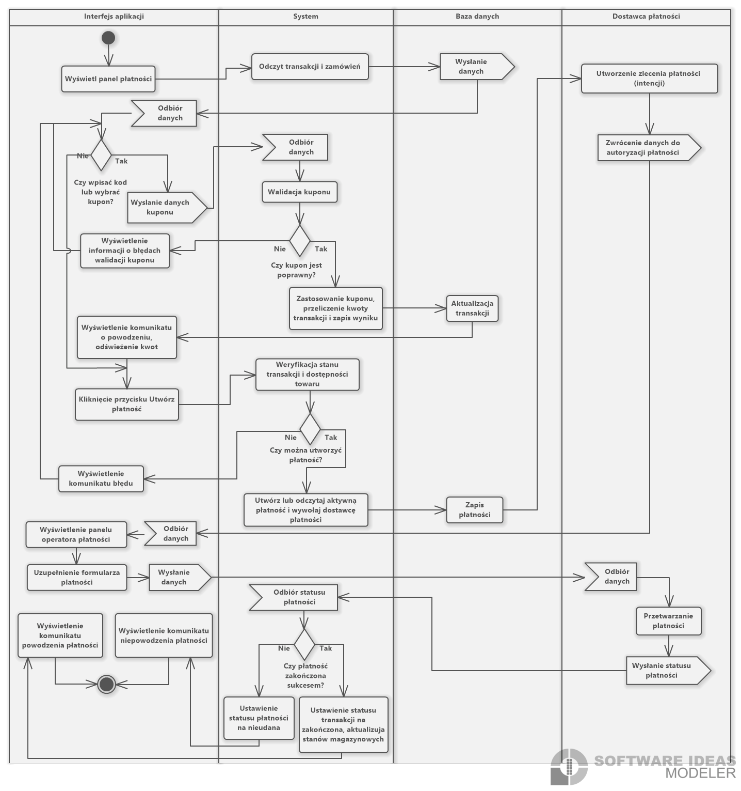

### In-store sale

A store employee selects stock from their location. A completed sales transaction and order are recorded; quantities are decremented and listings are marked as sold when stock is exhausted. This uses the same underlying inventory domain as online sales.

[View the in-store sale sequence diagram](docs/workflows/offline-sale-sequence.png).

### Pawn agreement lifecycle

A staff member records the customer, pledged items, appraisals, principal and due date. The agreement can then be extended, redeemed or marked as forfeited; forfeited items can optionally be listed for sale. Online extensions are finalized only after successful payment.

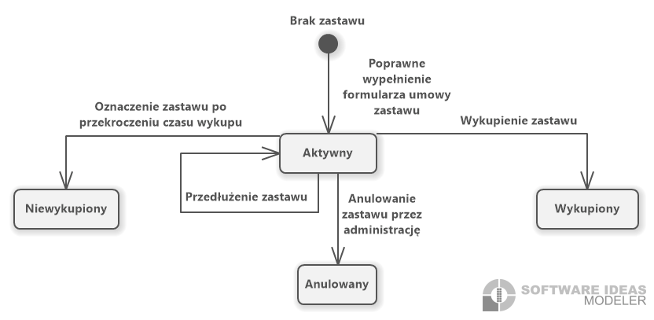

[See pawn agreement form, pawn list and PDF preview](docs/gallery/README.md#pawn-agreements--in-store-processes).

## Security and data consistency

The prototype implements JWT access/refresh authentication with HttpOnly cookies, hashed refresh-token references, CSRF protection for state-changing requests, permission checks by role and store membership, and request throttling. WebSocket connections use short-lived reference tokens. Payment callbacks and selected financial workflows include idempotency safeguards.

These measures are **implemented prototype features**, not a claim of a completed external security audit.

## Repository layout

The repository is organized into domain-focused Django applications:

```text
MyCent/
├── src/
│   ├── config/             # Django settings, ASGI / WSGI, Celery
│   ├── identity/           # Accounts, authentication, roles
│   ├── catalog/            # Product category schemas
│   ├── listings/           # Offers, stock, performance test scenarios
│   ├── carts/              # Shopping cart
│   ├── orders/             # Checkout and in-store sales
│   ├── pawns/              # Pawn agreement lifecycle
│   ├── transactions/       # Shared financial transaction model
│   ├── payments/           # Payment adapters and workflows
│   ├── coupons/            # Coupons and loyalty rewards
│   ├── customers/          # Customer records
│   ├── chat/               # REST and WebSocket messaging
│   ├── saved/              # Saved listings and searches
│   ├── shipping/           # Delivery configuration
│   ├── services/           # Additional service modules
│   ├── common/             # Cross-cutting utilities
│   ├── templates/          # Django HTML and email templates
│   ├── static/             # CSS, JS and app assets
│   └── manage.py
├── docs/                    # This README's screenshots, diagrams, charts
├── docker-compose.yml
├── docker-compose.test.yml
├── Dockerfile
├── Caddyfile
├── requirements.txt
└── package.json
```

## Running locally with Docker

Development uses Docker Compose. Configure local environment variables for Django, PostgreSQL, Redis and optional Stripe test payments before starting.

1. Install Docker Desktop (or a compatible Docker Engine + Compose setup).
2. Create a local `.env.docker` file with the environment values required by your Compose configuration (Django secret, PostgreSQL, Redis/Celery and optional Stripe test keys). Do not commit secrets.
3. Build and start the containers:

   ```bash
   docker compose build
   docker compose up -d
   ```

4. In the project configuration, the following local URLs are used:

   | Service | URL |
   | --- | --- |
   | Web app | `https://localhost` |
   | Django Admin | `https://localhost/admin/` |
   | Mailpit | `http://localhost:8025` |

Depending on configuration, local HTTPS may use a development certificate. Stripe test payments require test credentials and webhook forwarding.

## Testing and performance

The work includes unit tests, API/integration tests and manual end-to-end scenarios around checkout, in-store sales, pawn agreements, roles, coupons, chat and saved searches. Test modules are distributed under `src/*/tests/`; the Locust scenario is located at `src/listings/perf/locustfile.py`.

A **local Locust load test**, run with 150 concurrent users (ramp-up: 3 users/sec), on an AMD Ryzen 7 5800H machine with 24 GB RAM and four Uvicorn workers:

| Measurement | Result |
| --- | ---: |
| HTTP requests in the reported endpoint sample | **67,039** |
| Failed requests in that sample | **121 (≈0.18%)** |
| Throughput after ramp-up | **~80–100 requests/sec** |
| Median login response time | **290 ms** |
| Median public listing response time | **720 ms** |
| Median checkout response time | **930 ms** |
| Checkout 99th-percentile response time | **2,200 ms** |

| Throughput over time | Response-time percentiles |
| :---: | :---: |
| 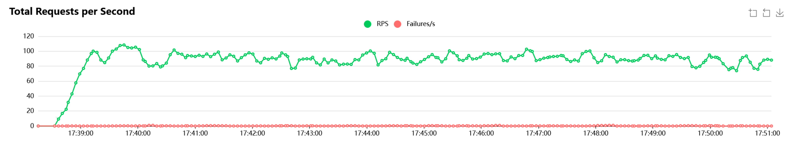 | 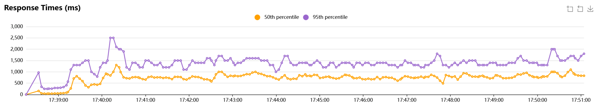 |

The failures were primarily connection resets under load, with some checkout validation errors. These are **results from one local test scenario**, not a production performance SLA.

## Limitations and possible next steps

This is a technical prototype. It does not fully implement the legal requirements of commercial pawnshop operations; deploying it with real customers would require dedicated legal/privacy review, stronger operational safeguards, and production-grade security, backups and monitoring. More advanced financial reporting, accounting integrations, multi-currency support, UI automation and longer-running stress tests were outside the implemented scope.

Planned directions include richer analytics, end-to-end UI tests, external accounting/marketplace integrations, further UX improvements and expanded loyalty features.

## Project background

Created as an engineering-thesis project: **“Project and Implementation of a Web-based System for Comprehensive Management of Sales, Pawns, and Customer Service in a Pawnshop.”** The thesis covers requirements analysis, UML/ERD modeling, implementation, integration scenarios and verification.

Visual documentation, including UI screenshots, architecture diagrams and load-test charts, is available in [`docs/`](docs/README.md).


