# MyCent

**System webowy do obsługi lombardów i sprzedaży wielokanałowej.**

MyCent to projekt inżynierski integrujący sprzedaż stacjonarną i internetową, obsługę zastawów oraz relacje z klientami w jednej aplikacji. Został zaprojektowany z myślą o sieci placówek, w której stany magazynowe, zamówienia, transakcje oraz uprawnienia personelu powinny działać spójnie w obu kanałach sprzedaży.

> **Status:** działający prototyp techniczny opracowany w ramach pracy inżynierskiej. Nie jest to gotowy system produkcyjny ani rozwiązanie posiadające pełną zgodność z przepisami dotyczącymi działalności lombardowej.

[English README](README.md) · [Galeria zrzutów](docs/gallery/README.md) · [Diagramy i ERD](docs/README.md) · [Wyniki testów](#testy-i-wydajność)

## Podgląd aplikacji

<p align="center">
  <a href="docs/gallery/storefront/home-light.png">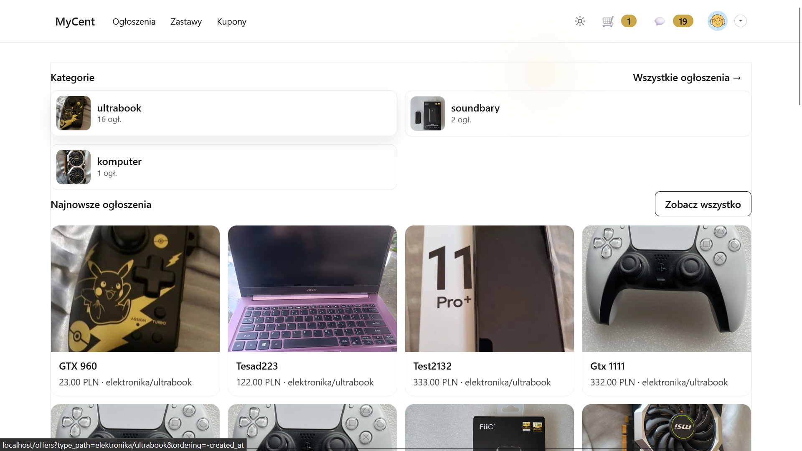</a>
</p>

<p align="center"><sub>Strona główna · ogłoszenia · jasny motyw</sub></p>

| Wyszukiwanie i filtrowanie | Szczegóły oferty i koszyk |
|:---:|:---:|
| <a href="docs/gallery/marketplace/listings-filters.png">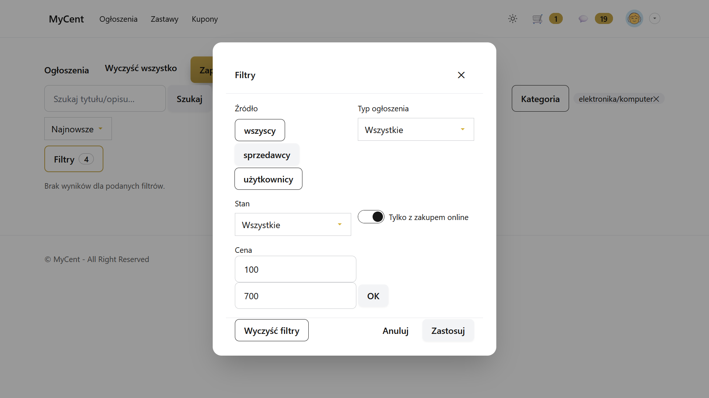</a> | <a href="docs/gallery/marketplace/item-detail.png">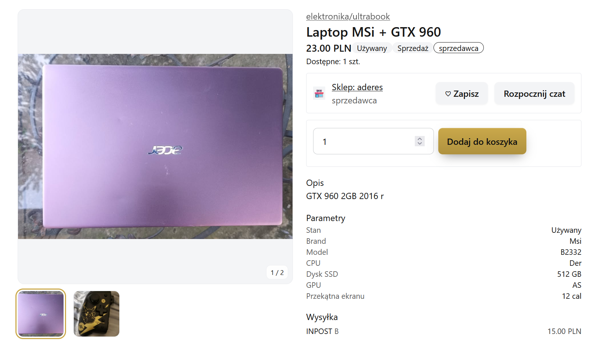</a> |
| **Sprzedaż stacjonarna** | **Szczegóły zastawu** |
| <a href="docs/gallery/checkout/pos-stock-picker.png">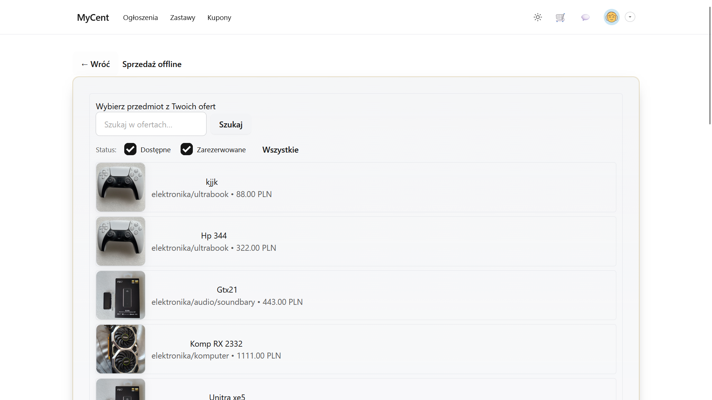</a> | <a href="docs/gallery/pawns/pawn-agreement-detail.png">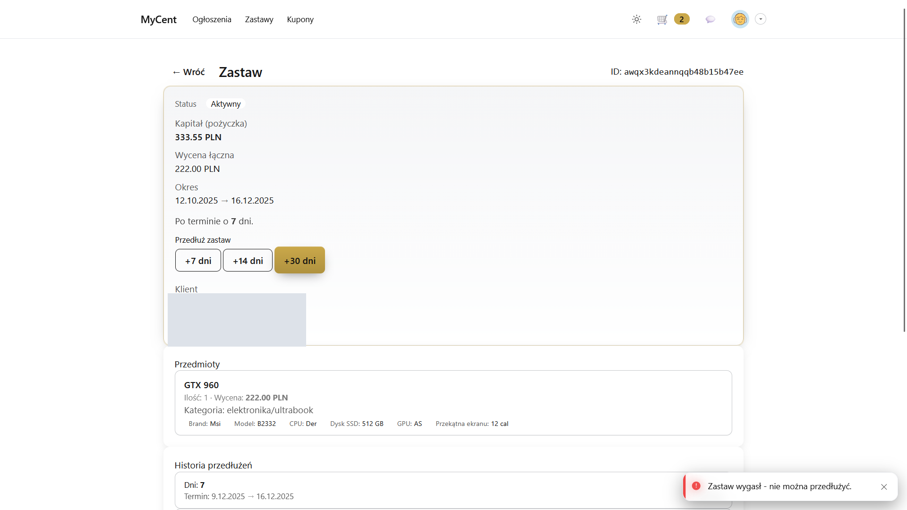</a> |

| Czat WebSocket | Zamówienie i płatność |
|:---:|:---:|
| <a href="docs/gallery/communication/chat-conversation.png">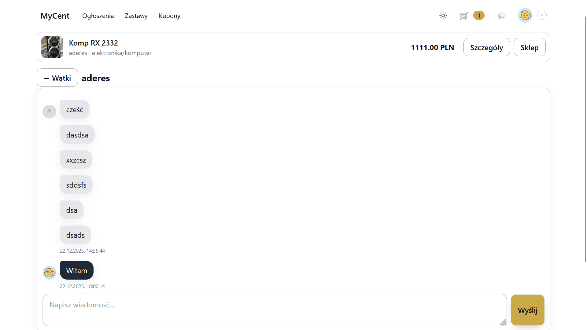</a> | <a href="docs/gallery/checkout/checkout-order.png">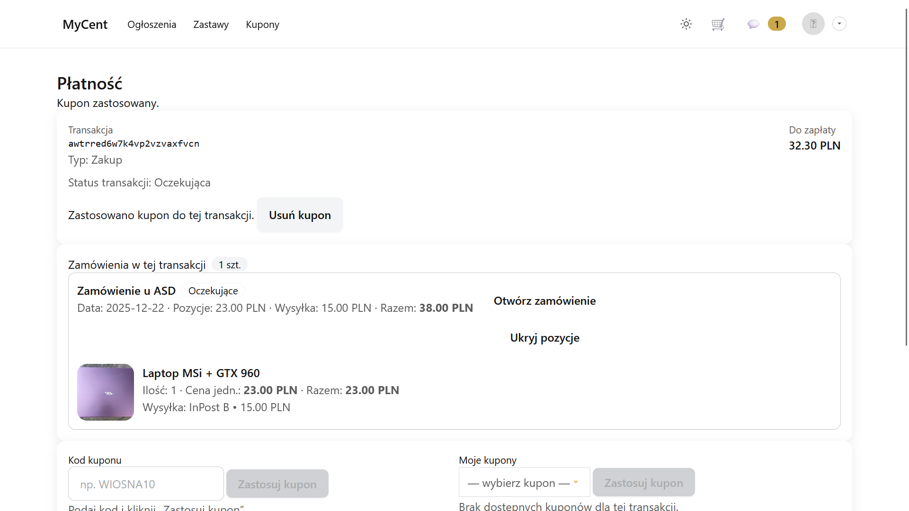</a> |

[**Zobacz wszystkie 72 zrzuty aplikacji →**](docs/gallery/README.md) · [Diagramy UML, ERD i wykresy](docs/README.md)

## Najważniejsze funkcjonalności

| Obszar | Zakres |
| --- | --- |
| **Lombard** | Tworzenie umów zastawu, wycena przedmiotów, przedłużenia, wykupy, obsługa niewykupionych zastawów i opcjonalne wystawianie przedmiotów na sprzedaż. |
| **Ogłoszenia** | Katalog kategorii, oferty publiczne, wyszukiwanie, filtry, szczegóły produktów, zapisane ogłoszenia i wyszukiwania. |
| **Sprzedaż** | Koszyk, checkout online, sprzedaż w placówce, zamówienia, rezerwacje towaru i aktualizacja magazynu. |
| **Płatności** | Wspólny model transakcji, integracja Stripe i testowy operator płatności, kupony rabatowe i punkty lojalnościowe. |
| **Klienci i sklepy** | Centralna kartoteka klientów, profile sklepów, członkostwa pracowników, role i kontrola uprawnień. |
| **Komunikacja** | Czat w czasie rzeczywistym, powiadomienia, wiadomości e-mail oraz alerty o spadku cen. |
| **Administracja** | Django Admin, moderacja ogłoszeń, zarządzanie użytkownikami, dokumentacja REST API w OpenAPI / Swagger UI. |

## Technologie

| Warstwa | Narzędzia |
| --- | --- |
| Backend i REST API | Python, Django, Django REST Framework, JWT, OpenAPI / Swagger UI |
| Frontend | Szablony Django, JavaScript, HTMX, Alpine.js, Tailwind CSS, DaisyUI |
| Dane i komunikacja | PostgreSQL, Redis |
| Zadania w tle | Celery i zadania harmonogramu |
| Czat | Django Channels, ASGI, WebSocket |
| Płatności | Stripe API / webhooki, adapter testowy |
| Uruchomienie | Docker, Docker Compose, Caddy, Mailpit, Stripe CLI |
| Testy | Testy jednostkowe i integracyjne Django, Locust |

## Architektura

MyCent wykorzystuje **modularny monolit** — niezależne logicznie aplikacje Django współdzielą relacyjną bazę danych. Reguły biznesowe realizowane są w warstwie usług, a komunikacja z przeglądarką wykorzystuje HTML, REST API i WebSocket.

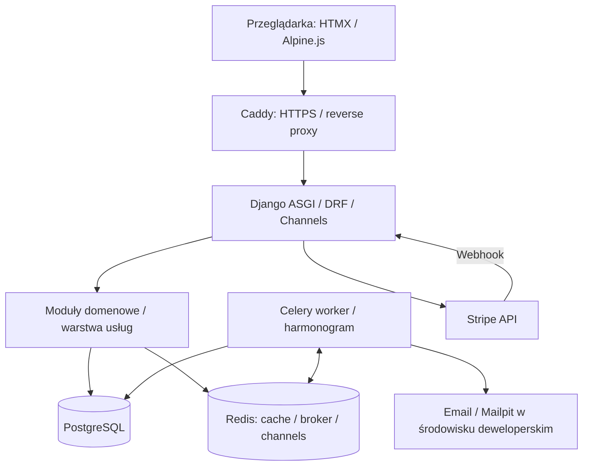

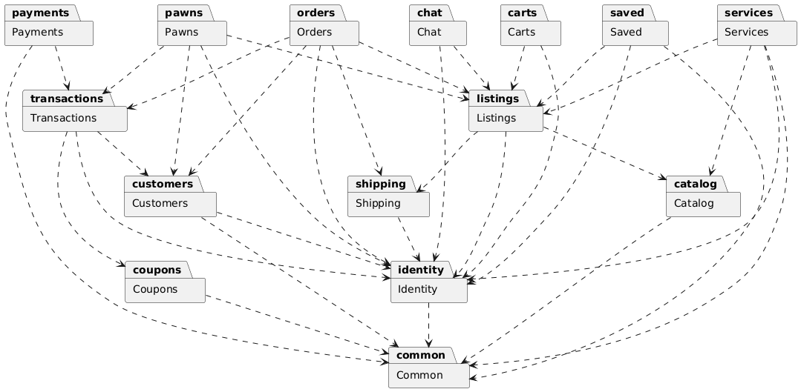

### Model bazy danych — ERD

Model relacyjny systemu jest udokumentowany na dwóch częściach diagramu ERD. Poniżej umieszczono jego podgląd bezpośrednio w README; szczegóły tabel i relacji można obejrzeć po otwarciu diagramów w pełnym rozmiarze.

<p align="center">
  <a href="docs/architecture/erd-part-1.png">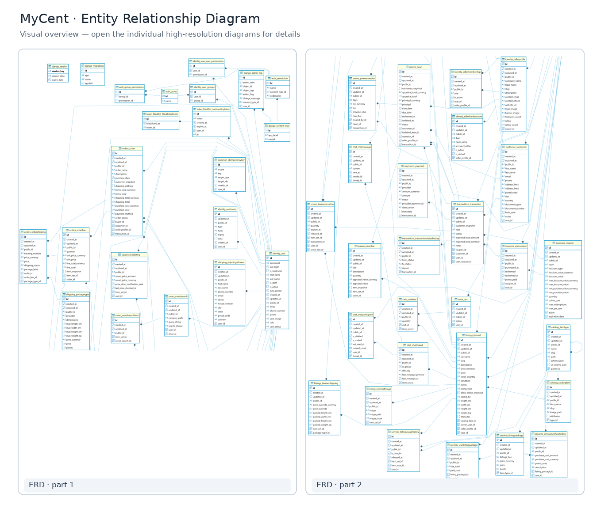</a>
</p>

[**ERD — część 1**](docs/architecture/erd-part-1.png) · [**ERD — część 2**](docs/architecture/erd-part-2.png) · [Wszystkie diagramy](docs/README.md)


W projekcie wydzielono m.in. `identity`, `catalog`, `listings`, `carts`, `orders`, `pawns`, `transactions`, `payments`, `coupons`, `customers`, `shipping`, `saved`, `services` i `chat`, a także moduły wspólne (`common`, `core`, `config`).

**Istotne rozwiązania techniczne:** wspólna encja `Transaction` dla operacji finansowych; czasowe rezerwacje towaru (`ItemReservation`) i blokady w PostgreSQL; transakcje `atomic`; oddzielenie widoków API od komend domenowych; snapshoty danych historycznych; zadania asynchroniczne w Celery.

[Diagram klas domenowych](docs/architecture/business-domain-classes.png)

## Kluczowe procesy

### Zakup internetowy

Klient dodaje ofertę do koszyka. Checkout tworzy transakcję `PURCHASE` ze statusem `PENDING`, zamówienia i rezerwacje magazynowe. Po wyborze dostawy i ewentualnym zastosowaniu kuponu następuje inicjacja płatności. Potwierdzenie operatora finalizuje transakcję i aktualizuje powiązane zamówienia.

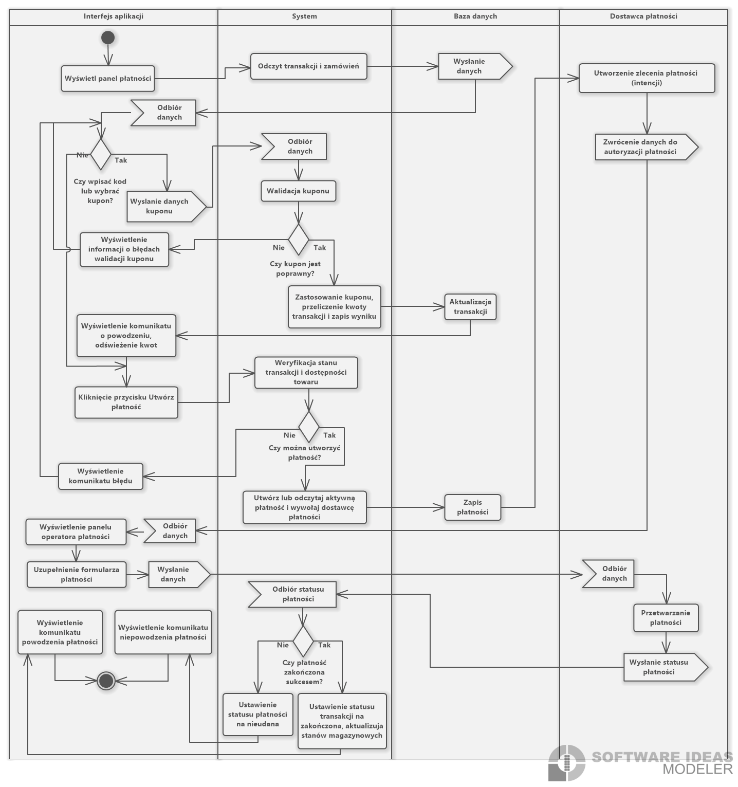

### Sprzedaż w placówce

Pracownik sklepu rejestruje sprzedaż wybranych przedmiotów. System tworzy zakończoną transakcję i zamówienie, aktualizuje ilości magazynowe oraz — w razie wyczerpania zasobów — status oferty. Sprzedaż online i offline współdzieli model towarów.

[Diagram sekwencji sprzedaży stacjonarnej](docs/workflows/offline-sale-sequence.png)

### Cykl życia zastawu

Pracownik tworzy umowę, dodaje przedmioty, wycenę, kwotę pożyczki i termin wykupu. System obsługuje przedłużenia, wykupy i niewykupienie zastawu w terminie. Dla wybranych procesów umożliwia zdalne rozliczenie płatności oraz wystawienie przedmiotu na sprzedaż po niewykupieniu.

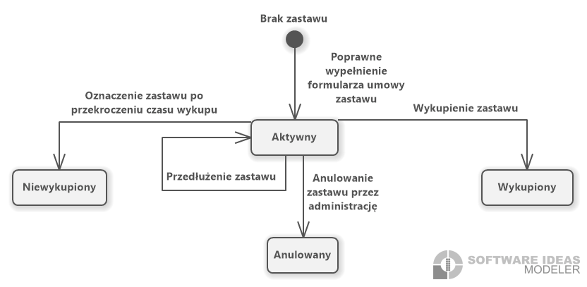

## Bezpieczeństwo i spójność danych

W prototypie zastosowano JWT w ciasteczkach HttpOnly, skróty tokenów odświeżających, ochronę CSRF, kontrolę uprawnień według ról i członkostw w sklepach, ograniczenia liczby żądań oraz krótkotrwałe tokeny do połączeń WebSocket. Mechanizmy rezerwacji, blokad bazodanowych i idempotencji wspierają spójność procesów zakupowych i płatniczych.

Nie oznacza to przeprowadzenia niezależnego audytu bezpieczeństwa.

## Struktura repozytorium

```text
MyCent/
├── src/
│   ├── config/                  # Django, ASGI, Celery
│   ├── identity/                # Konta i uprawnienia
│   ├── catalog/                 # Kategorie i atrybuty
│   ├── listings/                # Ogłoszenia i testy Locust
│   ├── carts/                   # Koszyk
│   ├── orders/                  # Zamówienia i sprzedaż offline
│   ├── pawns/                   # Umowy zastawu
│   ├── transactions/            # Transakcje
│   ├── payments/                # Integracje płatnicze
│   ├── coupons/                 # Kupony i lojalność
│   ├── customers/               # Klienci
│   ├── chat/                    # Wiadomości i WebSocket
│   ├── saved/                   # Zapisane ogłoszenia/wyszukiwania
│   ├── shipping/                # Dostawy
│   ├── templates/               # Szablony HTML i e-mail
│   ├── static/                  # CSS i JavaScript
│   └── manage.py
├── docs/                         # Galeria i diagramy projektu
├── docker-compose.yml
├── docker-compose.test.yml
├── Dockerfile
├── Caddyfile
├── requirements.txt
└── package.json
```

## Uruchomienie lokalne

Aplikacja wykorzystuje środowisko Docker Compose. Przed uruchomieniem przygotuj lokalną konfigurację `.env.docker`, obejmującą wymagane zmienne Django, PostgreSQL, Redis/Celery i opcjonalnie testowe klucze Stripe.

```bash
docker compose build
docker compose up -d
```

W konfiguracji projektu aplikacja jest dostępna pod `https://localhost`, Django Admin pod `https://localhost/admin/`, a Mailpit pod `http://localhost:8025`. Podczas startu wykonywano migracje i inicjalizację konta administratora. Stripe wymaga poprawnych danych testowych i obsługi webhooków.

## Testy i wydajność

W projekcie znajdują się testy jednostkowe i integracyjne w `src/*/tests/`, a także scenariusze Locust w `src/listings/perf/locustfile.py`. Sprawdzano m.in. checkout, sprzedaż offline, tworzenie zastawu, autoryzację, kupony i inne przepływy użytkownika.

W ramach projektu wykonano lokalny test Locust dla **150 równoczesnych użytkowników** (przyrost 3 użytkowników/s), na komputerze AMD Ryzen 7 5800H z 24 GB RAM i czterema workerami Uvicorn.

| Metryka | Wynik |
| --- | ---: |
| Żądania w zestawieniu badanych endpointów | **67 039** |
| Nieudane żądania w tym zestawieniu | **121 (ok. 0,18%)** |
| Przepustowość po stabilizacji | **ok. 80–100 żądań/s** |
| Mediana logowania | **290 ms** |
| Mediana pobrania ogłoszeń | **720 ms** |
| Mediana checkoutu | **930 ms** |
| 99. percentyl checkoutu | **2200 ms** |

| Przepustowość | Czasy odpowiedzi |
| :---: | :---: |
| 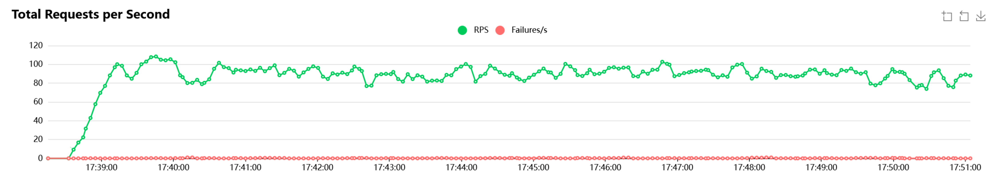 | 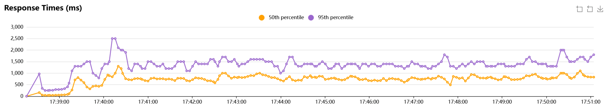 |

Błędy dotyczyły przede wszystkim zrywanych połączeń podczas obciążenia, a część niepowodzeń checkoutu wynikała z walidacji. Są to **wyniki jednego lokalnego testu**, a nie deklaracja wydajności na produkcji.

## Ograniczenia i kierunki rozwoju

System nie wdraża pełnych wymogów prawnych dla działalności lombardowej ani kompletnego zestawu zabezpieczeń operacyjnych dla prawdziwych danych klientów. Przed produkcyjnym uruchomieniem potrzebna byłaby analiza prawna i prywatności, zabezpieczenie infrastruktury, kopie zapasowe, monitoring oraz dodatkowe testy.

Możliwe rozszerzenia obejmują zaawansowane raportowanie, integracje księgowe i z marketplace'ami, testy end-to-end, doskonalenie UI i rozwój programu lojalnościowego.

## O projekcie

Projekt został przygotowany w ramach pracy inżynierskiej **„Projekt i implementacja systemu webowego do kompleksowego zarządzania sprzedażą, zastawami i obsługą klientów w lombardzie”**. Praca obejmuje analizę wymagań, UML, model ERD, implementację oraz testowanie.

Zrzuty ekranu, diagramy architektury, ERD i wykresy testów znajdują się w katalogu [`docs/`](docs/README.md).


