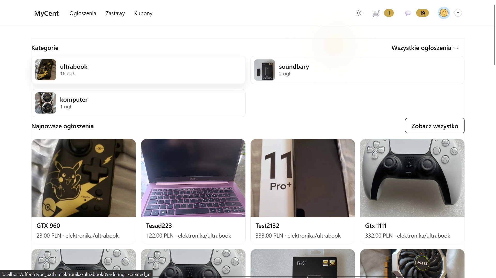
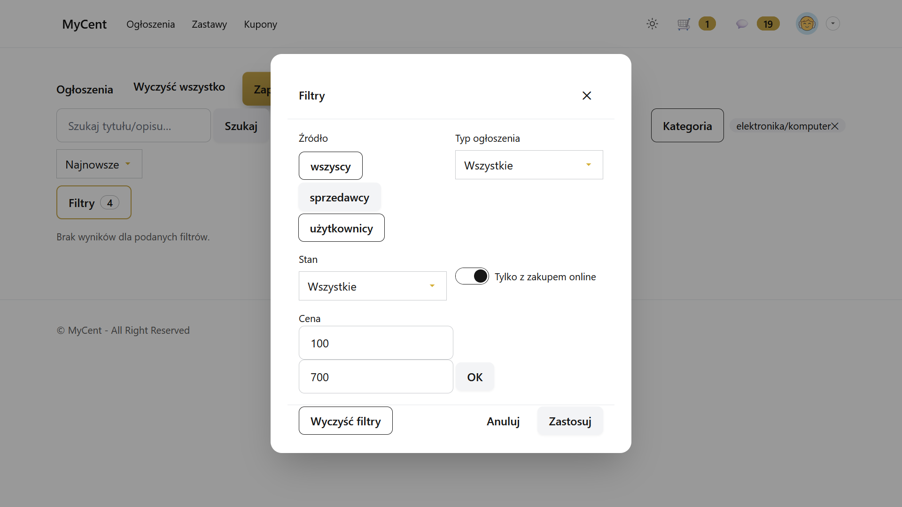
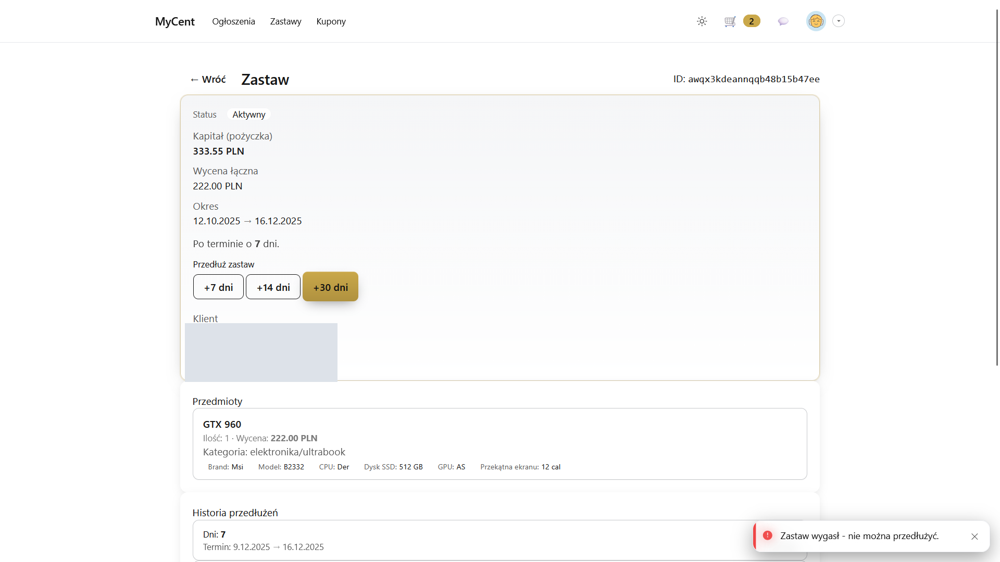
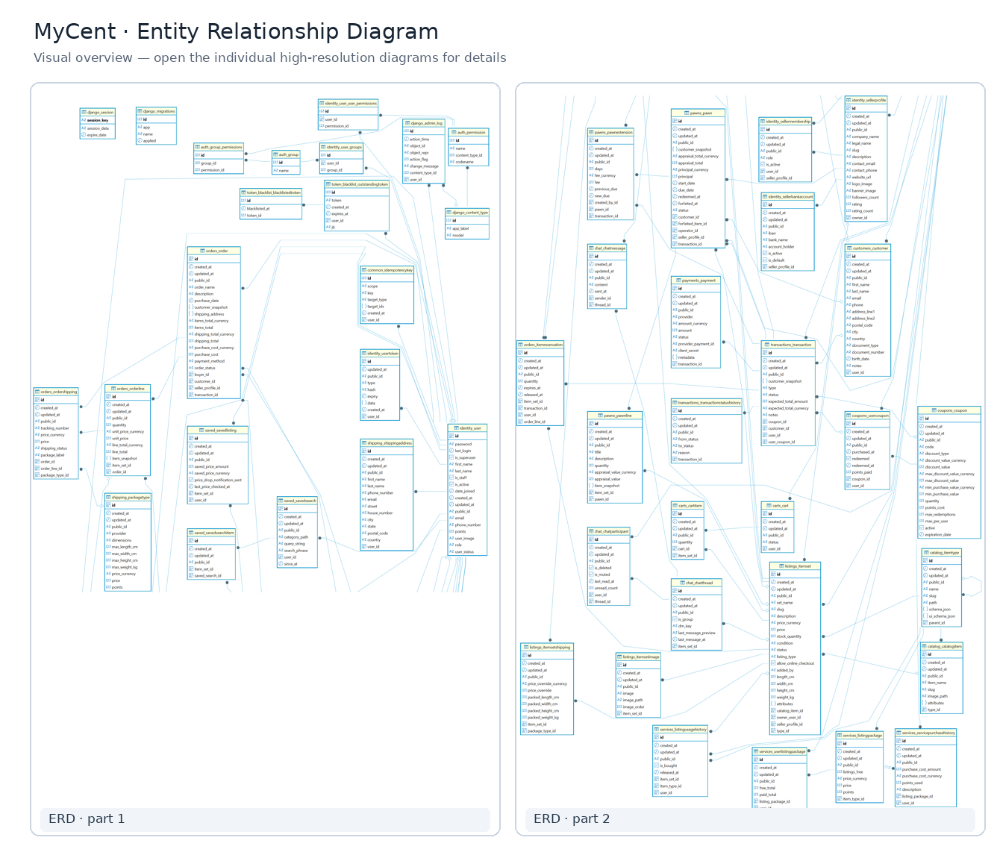
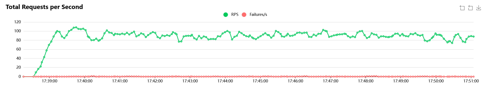
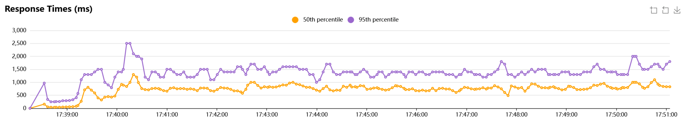
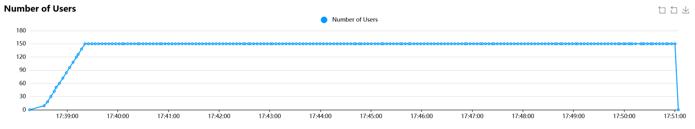

# MyCent — diagrams, screenshots & performance

Technical diagrams, application views and performance charts for the MyCent project.

[Main README](../README.md) · [Polska wersja](../README.pl.md) · [Full screenshot gallery](gallery/README.md)

## Application preview

| Storefront | Listings | Pawn agreement |
| :---: | :---: | :---: |
|  |  |  |

[Explore 72 application screenshots](gallery/README.md)

## Architecture & database model

| Diagram | Reference |
| --- | --- |
| [Use-case diagram](architecture/use-cases.png) | Figure 1, p. 19 |
| [Module dependencies](architecture/module-dependencies.png) | Figure 12, p. 33 |
| [Identity class diagram](architecture/identity-classes.png) | Figure 13, p. 34 |
| [Listings, catalog & shipping](architecture/listings-catalog-shipping-classes.png) | Figure 14, p. 35 |
| [Business-domain classes](architecture/business-domain-classes.png) | Figure 21, p. 71 |
| [ERD — part 1](architecture/erd-part-1.png) | Figure 22, p. 72 |
| [ERD — part 2](architecture/erd-part-2.png) | Figure 23, p. 73 |

## Business workflows

| Diagram | Reference |
| --- | --- |
| [Online payment — activity](workflows/online-payment-activity.png) | Figure 2, p. 24 |
| [In-store sale — activity](workflows/offline-sale-activity.png) | Figure 3, p. 25 |
| [Pawn creation — activity](workflows/pawn-creation-activity.png) | Figure 4, p. 26 |
| [Online payment — sequence](workflows/online-payment-sequence.png) | Figure 5, p. 27 |
| [In-store sale — sequence](workflows/offline-sale-sequence.png) | Figure 6, p. 27 |
| [Pawn creation — sequence](workflows/pawn-creation-sequence.png) | Figure 7, p. 28 |
| [User states](workflows/user-states.png) | Figure 8, p. 29 |
| [Listing states](workflows/listing-states.png) | Figure 9, p. 30 |
| [Order states](workflows/order-states.png) | Figure 10, p. 30 |
| [Pawn states](workflows/pawn-states.png) | Figure 11, p. 31 |
| [Detailed online-payment sequence](workflows/online-payment-sequence-detailed.png) | Figure 20, p. 70 |

## Performance results

| Throughput | Latency | Virtual users |
| :---: | :---: | :---: |
|  |  |  |

[Full load-test results and setup](performance/README.md)
