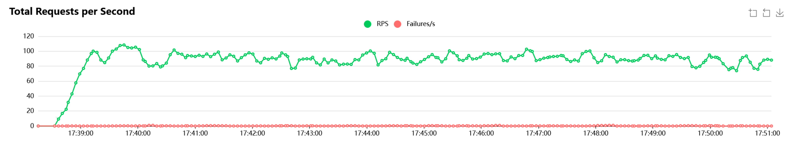
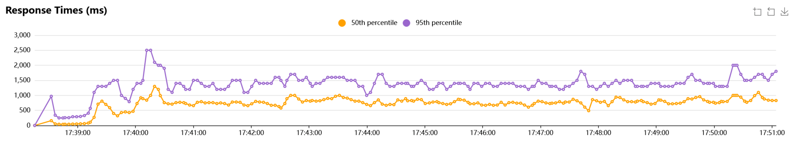
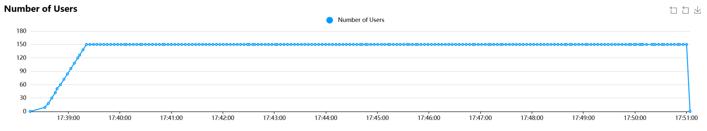

# MyCent — performance testing

[Main README](../../README.md) · [Screenshot gallery](../gallery/README.md)

## Locust load test

The project went through a local load-testing scenario for the MyCent backend.

| Metric | Value |
| --- | ---: |
| Concurrent virtual users | **150** |
| Ramp-up | **3 users/s** |
| Throughput after ramp-up | **~80–100 requests/s** |
| HTTP requests (selected endpoints) | **67,039** |
| Failed requests (selected endpoints) | **121 (0.18%)** |
| Checkout median response time | **930 ms** |
| Checkout P99 response time | **2,200 ms** |

**Test environment:** AMD Ryzen 7 5800H, 24 GB RAM, four Uvicorn workers running under Gunicorn, PostgreSQL and Redis.

## Results

### Requests per second

### Response times

### Concurrent users

The observed failures were predominantly connection resets under load, with some checkout validation errors. These results describe **one local test scenario**, not a production performance guarantee.
